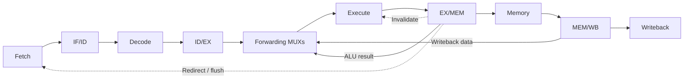

# MIPS32 — 5-Stage Pipelined Processor

A 32-bit MIPS-inspired processor designed in Verilog HDL. The project explores instruction pipelining, data forwarding and control hazard handling in an in-order, single-issue architecture.

## Key Features

- Five pipeline stages: IF, ID, EX, MEM and WB.
- 32 general-purpose registers, with R0 fixed to zero.
- Harvard-style architecture with separate 1024 × 32-bit instruction and data memories.
- Two phase-shifted clocks for alternate pipeline stages.
- EX/MEM and MEM/WB operand forwarding for RAW data dependencies.
- EX-stage branch resolution and wrong-path instruction flushing.
- Signed SLT/SLTI comparisons and byte-addressed memory accesses.

## Processor Architecture



| Stage | Function | Clock |
|---|---|---|
| IF | Fetch instruction and update PC | `clk1` |
| ID | Decode instruction, read registers and sign-extend immediate | `clk2` |
| EX | Select operands, execute ALU operations and resolve branches | `clk1` |
| MEM | Access data memory or pass the ALU result | `clk2` |
| WB | Write results to the register file | `clk1` |

## Supported Instructions

| Category | Instructions |
|---|---|
| Register arithmetic and logic | `ADD`, `SUB`, `AND`, `OR`, `SLT`, `MUL` |
| Immediate arithmetic | `ADDI`, `SUBI`, `SLTI` |
| Memory access | `LW`, `SW` |
| Conditional branches | `BEQZ`, `BNEQZ` |
| Jumps | `J`, `JAL`, `JR` |
| Control | `HLT` |

The processor supports 17 instructions using custom MIPS-style encodings. Each instruction is 32 bits wide, with a six-bit opcode.

## Hazard Handling

**Data hazards:** Two independent operand multiplexers select values from ID/EX, EX/MEM or MEM/WB by comparing source and destination register addresses. ALU results are forwarded from EX/MEM, while load results are forwarded from MEM/WB to avoid using the effective address as data. Forwarding also covers store data, branch operands and register-based jump targets.

**Control hazards:** Branch conditions and target addresses are evaluated in EX. A shared `redirect` signal updates the PC and invalidates younger wrong-path instructions. Internal NOPs prevent flushed instructions from modifying architectural state.

## Clocking and Performance

The testbench uses two 50 MHz clocks with a 5 ns phase offset. This allows loaded data to become available in MEM/WB before the dependent instruction captures its EX result, eliminating the usual load-use stall in this fixed-latency design.

| Metric | Expected value |
|---|---|
| Clock period | 20 ns |
| Fetch-to-writeback latency | 40 ns |
| Ideal steady-state CPI | 1 |
| ALU / load-use dependency penalty | 0 cycles |
| Taken branch / jump penalty | 2 cycles |
| Not-taken branch penalty | 0 cycles |

These values describe the RTL clock schedule, assuming fixed-latency memory and valid timing; they are not post-synthesis measurements.

## Files and Simulation

```text
├── mips32_pipeline.v    # Processor RTL
├── testbench_mips32.v   # Self-checking testbench
└── README.md
```

The testbench initializes the register file and memories directly, so a separate `program.mem` file is not required.

**Using Icarus Verilog:**

```bash
iverilog -g2012 -s MIPS32_forwarding_tb -o sim.out mips32_pipeline.v testbench_mips32.v
vvp sim.out
```

**Using Vivado:** Add the RTL as a design source and the testbench as a simulation source. Select `MIPS32_forwarding_tb` as the simulation top and run Behavioral Simulation.

The testbench checks forwarding, branch flushing, JAL, halt behavior, byte addressing and signed comparisons.

## Scope and Future Work

This is a MIPS-inspired educational design rather than a fully MIPS32-compliant core. It assumes aligned, in-range memory accesses and fixed-latency operation. Variable-latency memory support, exception handling, external interfaces and synthesis/STA are possible next steps.
