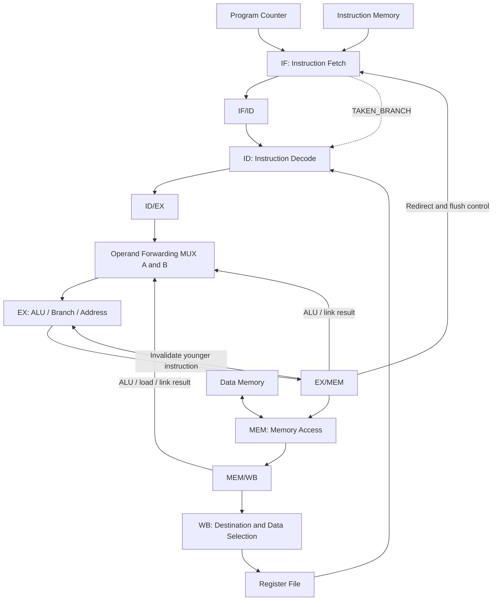

# MIPS32-Style 5-Stage Pipelined Processor

A 32-bit, single-issue, in-order pipelined processor implemented in Verilog HDL. The design uses a custom MIPS-inspired instruction set, separate instruction and data memories, two phase-shifted clocks, operand forwarding, and branch/jump flushing.

The current revision (**V4.1**) improves the original processor with complete EX/MEM and MEM/WB forwarding, corrected control-hazard handling, signed comparisons, and consistent byte addressing.

> This is an educational MIPS-inspired processor, not a fully MIPS32-compliant implementation. It uses custom opcodes and a limited instruction subset.

## Features

- Five pipeline stages: Instruction Fetch (IF), Instruction Decode (ID), Execute (EX), Memory Access (MEM), and Writeback (WB).
- 32-bit datapath and 32 general-purpose registers, with R0 architecturally fixed to zero.
- Harvard-style architecture: separate 1024 × 32-bit instruction and data memories (4 KiB each).
- 17 supported instructions covering arithmetic, logic, loads, stores, conditional branches, jumps, and halt.
- EX/MEM-to-EX and MEM/WB-to-EX forwarding for both source operands.
- Separate load-result forwarding, store-data forwarding, branch-operand forwarding, and jump-register forwarding.
- EX-stage branch resolution and wrong-path instruction invalidation.
- Dedicated internal NOP type for pipeline bubbles and reset initialization.
- Signed SLT/SLTI comparisons and byte-addressed instruction/data accesses.
- Directed, self-checking Verilog testbench.

## Architecture



| Stage | Function | Clock edge |
|---|---|---|
| IF | Fetch instruction, increment or redirect PC | `posedge clk1` |
| ID | Decode opcode, read registers, sign-extend immediate | `posedge clk2` |
| EX | Select forwarded operands, execute ALU, calculate addresses and branch conditions | `posedge clk1` |
| MEM | Read/write data memory or propagate the result | `posedge clk2` |
| WB | Select destination and writeback value; process HLT | `posedge clk1` |

Pipeline registers preserve each instruction's data and control information between stages:

| Register group | Contents |
|---|---|
| IF/ID | Instruction and next PC |
| ID/EX | Instruction, operands, immediate, next PC, instruction type |
| EX/MEM | Instruction, ALU result, store data or link address, branch condition, type |
| MEM/WB | Instruction, ALU result, loaded data, link data, type |

## Instruction Set

Instructions are 32 bits wide. The six-bit opcode occupies bits `[31:26]`.

| Instruction | Opcode | Operation |
|---|---|---|
| ADD | `000000` | `rd = rs + rt` |
| SUB | `000001` | `rd = rs - rt` |
| AND | `000010` | `rd = rs & rt` |
| OR | `000011` | Bitwise OR of rs and rt into rd |
| SLT | `000100` | `rd = signed(rs) < signed(rt)` |
| MUL | `000101` | Lower 32 bits of `rs * rt` into rd |
| LW | `001000` | Load word into rt from address `rs + imm` |
| SW | `001001` | Store rt at address `rs + imm` |
| ADDI | `001010` | `rt = rs + imm` |
| SUBI | `001011` | `rt = rs - imm` |
| SLTI | `001100` | `rt = signed(rs) < signed(imm)` |
| BNEQZ | `001101` | Branch if rs is nonzero |
| BEQZ | `001110` | Branch if rs is zero |
| J | `001111` | Unconditional jump |
| JAL | `010000` | Jump and save `PC + 4` in R31 |
| JR | `010001` | Jump to address held in rs |
| HLT | `111111` | Halt processor at writeback |

### Instruction formats

```text
R-type:       opcode[31:26] | rs[25:21] | rt[20:16] | rd[15:11] | unused[10:0]
I-type:       opcode[31:26] | rs[25:21] | rt[20:16] | immediate[15:0]
J / JAL:      opcode[31:26] | target[25:0]
JR:           opcode[31:26] | rs[25:21] | unused[20:0]
HLT:          opcode[31:26] | unused[25:0]
```

The 16-bit immediate is sign-extended to 32 bits. Decode generates a three-bit instruction category: `RR_ALU`, `RM_ALU`, `LOAD`, `STORE`, `BRANCH`, `HALT`, `JUMP`, or internal `NOP`.

## Clocking and Pipeline Timing

The supplied testbench generates two related 50 MHz clocks, each with a 20 ns period and a 5 ns (90°) phase offset. IF, EX and WB capture on `clk1`; ID and MEM capture on `clk2`.

| Instruction | IF | ID | EX | MEM | WB |
|---|---:|---:|---:|---:|---:|
| I1 | 25 ns | 30 ns | 45 ns | 50 ns | 65 ns |
| I2 | 45 ns | 50 ns | 65 ns | 70 ns | 85 ns |
| I3 | 65 ns | 70 ns | 85 ns | 90 ns | 105 ns |

The nominal cross-clock setup intervals are 5 ns (`clk1` to `clk2`) and 15 ns (`clk2` to `clk1`). Correct operation requires a stable clock relationship and sufficient setup/hold margins. The clocks are not asynchronous.

## Data Hazard Handling — Operand Forwarding

The forwarding unit resolves ordinary RAW (Read After Write) dependencies by comparing the actual source registers in ID/EX with writable destinations in EX/MEM and MEM/WB.

Destination selection depends on the instruction type: `rd` for register arithmetic, `rt` for immediate arithmetic and loads, and R31 for JAL. Writes targeting R0 are excluded.

Two independent 32-bit operand multiplexers use the following control encoding:

| ForwardA / ForwardB | Selected operand |
|---|---|
| `00` | Saved ID/EX operand |
| `10` | EX/MEM result (priority when valid) |
| `01` | MEM/WB result |

Forwarded operands are used for arithmetic, load/store effective addresses, store data, branch comparisons, and JR targets.

### Load-use dependencies

A load's `EX_MEM_ALUOut` contains the effective address, not the loaded value. EX/MEM forwarding is therefore disabled for LOAD instructions. The actual data is forwarded from `MEM_WB_LMD`.

For example, if LW executes at 45 ns, its memory result is captured at 50 ns and can be forwarded to the dependent EX stage before 65 ns. Under this fixed-latency schedule, no extra load-use stall is required.

The `hazard_detected` signal is diagnostic only; it does not stall the pipeline. There is no functional stall controller or variable-latency memory handshake in this revision.

## Control Hazard Handling — Branches and Jumps

Conditional branches are evaluated in EX using forwarded operands. The branch target is calculated as:

```text
Branch target = NPC + (sign_extended_immediate << 2)
```

J and JAL construct a target from the upper four bits of NPC, the 26-bit target field, and two trailing zeros. JR uses the forwarded source register as its target. JAL also preserves NPC as the return address for R31.

A shared combinational `redirect` signal generated from EX/MEM controls both IF and EX:

- IF redirects the PC, clears the fetched instruction, and asserts `TAKEN_BRANCH`.
- EX replaces the younger wrong-path instruction with an internal NOP before it reaches MEM or WB.
- ID inserts a NOP on the following `clk2` edge.
- IF fetches the correct target on the next `clk1` edge.

Taken branches and jumps incur a two-cycle penalty. Not-taken branches incur no control penalty. Branch resolution remains in EX; early ID-stage resolution and dynamic branch prediction are not implemented.

## Memory and Register Handling

Both memories contain 1024 words of 32 bits. PC and load/store effective addresses are byte addresses, converted to word indices using a right shift by two.

```verilog
IF_ID_IR  <= InstrMem[PC >> 2];
MEM_WB_LMD <= DataMem[EX_MEM_ALUOut >> 2];
DataMem[EX_MEM_ALUOut >> 2] <= EX_MEM_B;
```

For example, byte address 100 corresponds to `DataMem[25]`; byte address 104 corresponds to `DataMem[26]`.

Writeback uses the current instruction's combinational destination and result selection. R0 reads return zero, and writes to R0 are suppressed. SLT and SLTI use `$signed` casts for correct two's complement comparisons.

The active-high synchronous reset initializes the PC, pipeline registers and control flags. Register-file and memory contents are initialized by the testbench. Internal NOP bubbles are distinct from HLT; the all-zero instruction encoding represents `ADD R0,R0,R0`, not an explicit NOP opcode.

## Expected Performance

| Metric | Value under the supplied simulation schedule |
|---|---|
| Clock frequency | 50 MHz per clock |
| Fetch-to-writeback elapsed latency | 40 ns (2 full clock periods) |
| Ideal steady-state CPI | 1 |
| Ideal throughput | 1 instruction per 20 ns |
| Ordinary ALU RAW penalty | 0 cycles |
| Immediate load-use penalty | 0 cycles |
| Taken branch / jump penalty | 2 cycles |
| Not-taken branch penalty | 0 cycles |

These are architectural timing expectations for fixed-latency operation, not measured post-synthesis performance or timing closure results.

## File Structure

```text
.
├── mips32_pipeline_final.v   # Current processor RTL (module mips32_pipeline)
├── testbench_mips32_final.v        # Self-checking testbench (MIPS32_forwarding_tb)
└── README.md              # Project documentation
```

If the RTL and testbench are renamed to `mips32_pipeline.v` and `testbench.v` in the repository, use those filenames in the commands below. Compile only one RTL revision at a time to avoid duplicate module definitions.

An optional `program.mem` file may be included for external program initialization. The current RTL and testbench do not call `$readmemh`; the testbench loads instructions directly into `uut.InstrMem` using encoding helper functions. A separate memory file is not required.

## Simulation

### Vivado

1. Add `mips32_pipeline_v4_1.v` as a Design Source.
2. Add `testbench_v4_1.v` as a Simulation Source.
3. Set `MIPS32_forwarding_tb` as the simulation top.
4. Run Behavioral Simulation and inspect the console and waveforms.

### Sample program from the testbench

The testbench initializes R2 = 100, R4 = 10, and `DataMem[25] = 55`.

```asm
LW   R1, 0(R2)       ; R1 = 55
ADD  R3, R1, R4      ; R3 = 65 (load forwarding)
ADD  R5, R3, R3      ; R5 = 130 (both operands forwarded)
SW   R5, 4(R2)       ; DataMem[26] = 130
LW   R6, 4(R2)       ; R6 = 130
SUB  R7, R6, R5      ; R7 = 0
BEQZ R7, +2          ; Skip the next two instructions
```

The full testbench continues with jump flushing, consecutive register writes, JAL link handling, signed comparisons, and HLT.

| Example expected state | Value |
|---|---:|
| R1 | 55 |
| R3 | 65 |
| R5, R6 | 130 |
| R7 | 0 |
| R8 | 10 |
| R9 | 20 |
| R31 | 52 |
| DataMem[26] | 130 |
| DataMem[27] | 0 (wrong-path and post-HLT stores must not commit) |
| HALTED | 1 |

The self-checking testbench prints the following message if all its checks succeed:

```text
PASS: forwarding, branch flush, JAL, halt, byte addressing and signed comparison checks
```

The testbench checks selected directed scenarios, not exhaustive coverage of every supported instruction or corner case.

### Useful waveform signals

`clk1`, `clk2`, `reset`, `PC`, `IF_ID_IR`, `ID_EX_IR`, `EX_MEM_IR`, `MEM_WB_IR`, `ForwardA`, `ForwardB`, `forward_A`, `forward_B`, `mem_dest`, `wb_dest`, `hazard_detected`, `EX_MEM_ALUOut`, `MEM_WB_LMD`, `redirect`, `TAKEN_BRANCH`, `HALTED`.

## Limitations and Future Work

- Custom instruction encodings; standard MIPS binaries are not directly supported.
- Fixed-latency internal memories and no functional pipeline stall controller.
- No alignment or address-range exception handling; programs must use valid aligned addresses within memory.
- Unsupported opcodes decode as HALT; arithmetic overflow exceptions are not implemented.
- Memory and register initialization is performed by the testbench.
- The current top-level module exposes only clock and reset inputs. External memory interfaces and observable outputs are needed for practical hardware integration and meaningful synthesis results.
- Maximum operating frequency, area, power and timing closure require synthesis and static timing analysis.

Potential future extensions include early branch resolution, branch prediction, variable-latency memory support, explicit exception handling, and ASIC PPA analysis.

## Revision History

| Revision | Main changes |
|---|---|
| V1 | Initial five-stage pipeline and basic hazard detector |
| V2 | Shared branch redirect, wrong-path invalidation, dedicated NOP |
| V3 | Instruction-aware source/destination dependency detection and stall-control proposal |
| V4 | Both forwarding paths, removal of unnecessary RAW stalls, corrected instruction indexing, branch offsets, writeback and HALTED control |
| V4.1 | Signed SLT/SLTI and byte-addressed data memory |
